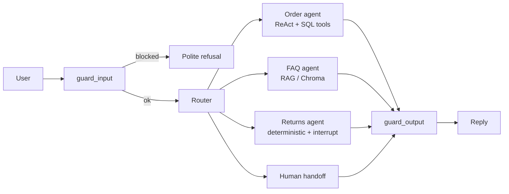

# Customer Service Chatbot (LangGraph)


A multi-agent customer-service bot for a **fictional** online shop ("ShopNow"), built with LangGraph.
It answers in German, looks up orders, answers FAQs from company documents (RAG), and handles returns
with a **human-in-the-loop approval step** before any refund is granted.

> All company data, orders and documents in this repository are fictional and for demonstration only.

## Architecture



| Component | What it does |
|---|---|
| **Input guard** | Rejects empty/oversized messages and known prompt-injection phrases (German/English) |
| **Router** | Classifies the request (`order`, `faq`, `returns`, `human`) via LLM with structured output; falls back to `faq` on failure |
| **Order agent** | ReAct loop with tools for order status and tracking (SQLite, parameterized queries) |
| **FAQ agent** | Retrieval from Chroma (Ollama embeddings), answers only from context, sources appended by code |
| **Returns agent** | No LLM involved. Checks the order, then `interrupt()`s until a human approves or rejects |
| **Output guard** | Replaces replies containing e-mail addresses, IBANs or system-prompt fragments with a polite refusal |
| **Persistence** | Postgres checkpointer (conversations and pending approvals survive restarts); in-memory fallback |
| **API** | FastAPI: `/chat`, `/review`, `/health` |

## Design decisions

- **Money-related actions are never taken by the LLM.** The return flow is plain code; the graph freezes at `interrupt()` and only continues with an explicit human decision (anything other than `approve` means reject).
- **Deterministic where possible.** Guardrails are regex/rule based, source citations are added by code, and an empty retrieval result skips the LLM entirely.
- **Dependency injection.** `build_graph(llm, checkpointer, retriever)` lets tests run with fake LLMs and in-memory state, and lets the production setup swap in Postgres or another model without touching graph logic.
- **Swappable model.** The LLM provider is configured via environment variables (`ollama` by default, `anthropic` supported in `llm.py`).

## Quick start (Docker)

Requirements: Docker, and [Ollama](https://ollama.com) running on the host.

```bash
ollama pull qwen2.5:3b
ollama pull nomic-embed-text

docker compose up -d --build
docker compose exec api python scripts/seed_db.py
docker compose exec api python scripts/ingest_docs.py
```

Open **http://localhost:8000/docs** and try the endpoints.

### Example: return with human approval

```bash
# 1) Customer asks for a return -> the graph pauses
curl -X POST localhost:8000/chat -H "Content-Type: application/json" \
  -d '{"thread_id":"demo","message":"Ich will SN-1003 zurückgeben"}'
# -> {"status":"pending_review", "review": {...}}

# 2) Staff decides
curl -X POST localhost:8000/review -H "Content-Type: application/json" \
  -d '{"thread_id":"demo","approved":true}'
# -> {"status":"ok","reply":"Ihre Retoure ... wurde genehmigt ..."}
```

While a return is pending, `/chat` for that thread returns `409`.

## Local development

```bash
python -m venv .venv
.venv\Scripts\activate          # Windows
pip install -e ".[dev]"
cp .env.example .env

python scripts/seed_db.py
python scripts/ingest_docs.py
python scripts/chat_cli.py                       # terminal chat
python -m uvicorn support_bot.api:app --reload   # API
```

By default the in-memory checkpointer is used. For Postgres: `docker compose up -d postgres` and set
`SHOPNOW_CHECKPOINTER_BACKEND=postgres` in `.env`.

## Tests

```bash
python -m pytest                  # unit tests, no Docker/Ollama needed (fake LLMs)
python -m pytest -m integration   # Postgres persistence + real embeddings (needs Docker + Ollama)
ruff check .
```

The unit tests cover routing, guardrails, tools, the FAQ node, the return flow (including that the graph
pauses before any decision) and the API (validation, status codes, pending-review flow).
CI runs lint and unit tests on every push.

## Known limitations

- The model (`qwen2.5:3b`) is small. Routing quality was **not measured systematically**; the sensitive flows are deterministic for that reason.
- The input guard only covers German and English phrases and is one layer, not complete protection against prompt injection.
- No authentication: anyone who can reach `/review` can approve a return.
- Return eligibility is simplified (no e-mail ownership check, no return window).
- Replies are returned in one piece (no token streaming), because the output guard must inspect the full reply first.
- Order data lives in SQLite; only conversation state uses Postgres.

## Possible next steps

- Systematic evals (router accuracy, retrieval hit rate, refusal on out-of-scope questions)
- Authentication for `/review`, ownership check and return window
- Tracing (LangSmith/Langfuse) and structured logging
- Web chat UI and a larger model

## Project layout

```
src/support_bot/
  api.py, graph.py, state.py, router.py, guardrails.py
  agents/        order_agent, faq_agent, returns_agent, stubs
  rag.py, tools.py, db.py, llm.py, config.py, checkpointer.py
company_documents/   fictional knowledge base (Markdown)
scripts/             seed_db, ingest_docs, chat_cli
tests/
```

## License

free to use